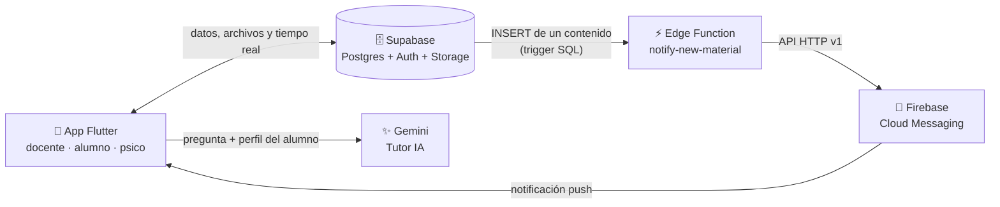

<div align="center">

# 🌈 EduInclusiva IA

### Un tutor con inteligencia artificial que se adapta a cada alumno

Plataforma escolar accesible para **docentes**, **alumnos** y **psicopedagogas**,
pensada para que cada estudiante aprenda a su ritmo, con los apoyos que necesita.


</div>

---

## ✨ ¿Qué es?

EduInclusiva IA conecta tres roles de la escuela en una sola app:

- El **docente** publica contenidos en las materias que da.
- El **alumno** estudia con un **Tutor IA** que lee esos contenidos y le responde de la manera que mejor le sirve.
- La **psicopedagoga** configura el perfil de accesibilidad de cada alumno y hace el seguimiento de cómo trabaja.

> El tutor **no responde igual para todos**: si un alumno tiene dislexia, usa frases cortas;
> si tiene discalculia, explica la matemática paso a paso con ejemplos concretos.

---

## 👥 Qué hace cada rol

| | 🧑‍🏫 Docente | 🎒 Alumno | 🧠 Psicopedagoga |
| --- | --- | --- | --- |
| **Inicio** | Sus materias agrupadas por curso (ej. *1° 2da*) | Solo las materias de su curso, con buscador | Tabla de alumnos con filtros por condición |
| **Contenidos** | Sube PDF, Word o TXT y ve lo publicado | Descarga, abre sin conexión o *pregunta al Tutor IA* | Ve todo lo que suben los profes |
| **Seguimiento** | — | Avisos de contenido nuevo | Actividad semanal, chats, notas privadas |
| **Configuración** | Color y tema propios | Color y tema propios | Perfil de accesibilidad de cada alumno y materias por docente |

---

## ♿ Accesibilidad personalizada

La psicopedagoga asigna el perfil y el alumno **no puede modificarlo**.

| Condición | Cómo se adapta la app y el Tutor IA |
| --- | --- |
| **TEA** | Lenguaje literal y directo, en pasos numerados |
| **TDAH** | Modo foco, bloques cortos, una tarea por vez |
| **Dislexia** | Frases cortas, palabras simples, tipografía más espaciada |
| **Disgrafía** | No exige respuestas escritas largas; ofrece opciones |
| **Disortografía** | Entiende lo que quiso escribir, sin corregirlo |
| **Discalculia** | Pasos numerados, ejemplos cotidianos y números chicos |
| **Daltonismo** (7 tipos) | Paleta segura; nunca usa el color como única pista |
| **Apoyos** | Lengua de señas, lectura en voz alta, alto contraste, tamaño de letra |

Además, **cada usuario elige su color principal** y su tema (claro, oscuro o el del teléfono).

---

## 🏗️ Arquitectura



**Notificaciones:** cuando un docente sube un contenido, los alumnos de ese curso reciben
un aviso en la barra de notificaciones, aunque tengan la app cerrada.

---

## 🚀 Cómo correrla

**Requisitos:** [Flutter](https://docs.flutter.dev/get-started/install) 3.x, un proyecto de Supabase
y una clave de la API de Gemini.

```bash
git clone https://github.com/franciscosherrera-tech/EducInclusiva_IA1.git
cd EducInclusiva_IA1
flutter pub get
flutter run --dart-define=GEMINI_KEY=tu_clave_de_gemini
```

**Generar el APK para instalar en un celular:**

```bash
flutter build apk --release --no-tree-shake-icons --dart-define=GEMINI_KEY=tu_clave_de_gemini
```

> `--no-tree-shake-icons` es necesario porque los íconos de las materias se guardan como número en la base de datos.

### Base de datos

Ejecutá los scripts de la carpeta [`supabase/`](supabase/) en el **SQL Editor**, en este orden:

1. `perfiles_accesibilidad.sql` — perfiles por alumno y reglas de acceso
2. `seguimiento_psico.sql` — la psicopedagoga puede leer chats y mensajes
3. `actividad_y_permisos.sql` — registro de descargas y permisos de materiales
4. `mejoras_v2.sql` — notas, materias asignadas por la psico y avisos en vivo
5. `notificaciones_fcm.sql` y `notificaciones_trigger.sql` — notificaciones push

### Notificaciones push

La guía paso a paso está en [`docs/GUIA_NOTIFICACIONES_FCM.md`](docs/GUIA_NOTIFICACIONES_FCM.md).
Sin configurarlas, la app funciona igual, solo que sin avisos con la app cerrada.

---

## 🧪 Pruebas

```bash
flutter test
```

22 pruebas automáticas cubren cursos, perfiles de accesibilidad, tema y color,
actividad diaria, el selector de apariencia, el gráfico de actividad y la lectura de archivos Word.

---

## 📁 Estructura

```
lib/
├── constants/    años y divisiones (1° a 3°, 1ra a 3ra)
├── models/       materia, contenido, perfil de accesibilidad
├── providers/    estado: usuario, materias, accesibilidad, contenido nuevo
├── screens/      pantallas de docente, alumno y psicopedagoga
├── services/     Supabase, Gemini, notificaciones, caché sin conexión
├── theme/        colores y temas claro/oscuro
├── utils/        lectura de Word, agrupación por curso
└── widgets/      gráfico de actividad, selector de apariencia
supabase/         scripts SQL y Edge Function
docs/             guías y documentación
test/             pruebas automáticas
```

---

## 🛣️ Próximos pasos

- [ ] Mover la clave de Gemini a una Edge Function antes de publicar la app
- [ ] Abrir la materia directamente al tocar una notificación
- [ ] Fechas límite y entregas del alumno en cada tarea
- [ ] Exportar el seguimiento de un alumno a PDF
- [ ] Versión para iPhone (requiere una Mac para compilar y probar)

---

<div align="center">

Hecho con 💜 para que **todos** puedan aprender.

</div>
